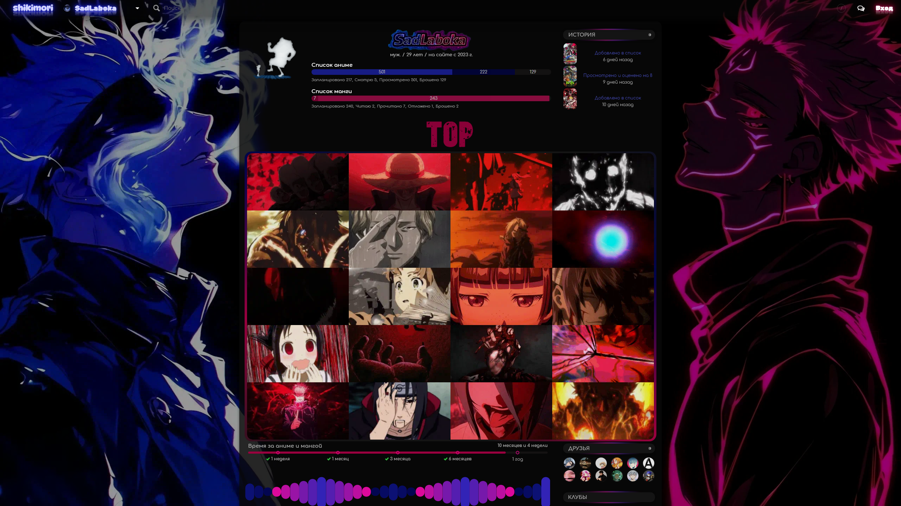
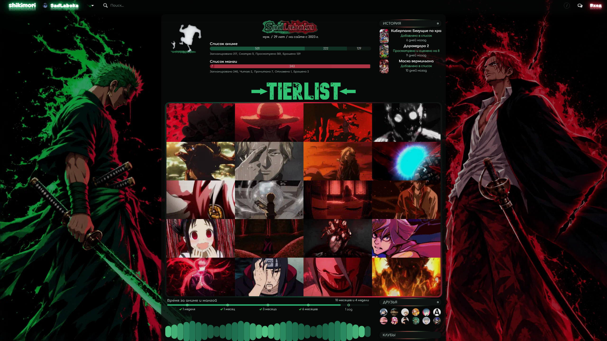
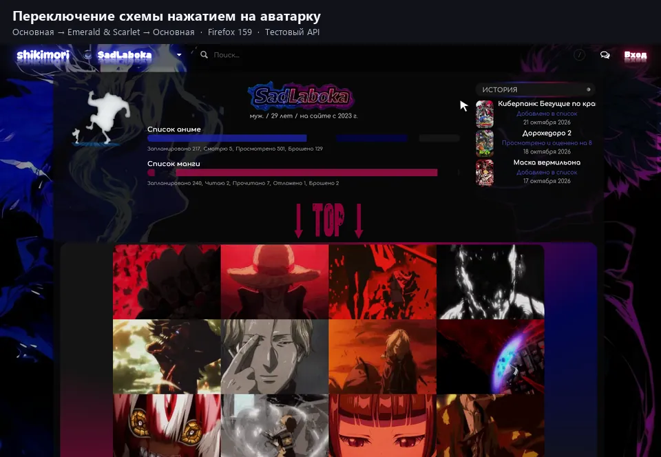

# Shikimori · SadLaboka

Оформление [профиля SadLaboka](https://shikimori.io/SadLaboka): две цветовые схемы,
анимированные фоны, меню, аватар, блок TOP, избранное, достижения, график активности
и фильтры. CSS действует на всём Shikimori, где применяется стиль профиля.

## Цветовые схемы

| Схема | Палитра и изображения | Полный CSS |
| --- | --- | --- |
| Основная | Синие и малиновые акценты, исходные фоны и анимации | [styles_optimized.css](styles_optimized.css) |
| Emerald & Scarlet | Изумрудные и алые акценты, Зоро слева и Шанкс справа, перекрашенные баннер и аватар | [styles.css](css/themes/emerald-scarlet/styles.css) |

27 октября 2026 года в профиле опубликована **Emerald & Scarlet**.
Основная схема сохранена отдельно. Для переключения заменяется **весь CSS**
выбранным файлом либо готовым блоком импортов через расширение Firefox;
две собранные схемы не нужно накладывать друг на друга.
[Устройство альтернативной схемы и возврат к основной](css/themes/emerald-scarlet/README.md).

### Основная схема



### Emerald & Scarlet



Снимки сделаны 27 октября 2026 года в Chromium, 2560 × 1440.
Основная схема показана через локальную подстановку CSS в браузере;
опубликованный профиль при съёмке не переключался. Скриншоты фиксируют отдельные
кадры анимаций. В Emerald & Scarlet боковые фоны включаются от ширины 1280 px.

## Расширение Firefox

Личное расширение [Shikimori · SadLaboka](extensions/firefox/) переключает
«Основную» и «Emerald & Scarlet» через API Shikimori. Оно меняет сохранённый CSS
аккаунта, используя уже выполненный вход в Firefox. Выбранное оформление будет
видно посетителям, которым сайт показывает тему профиля.

Перед записью расширение проверяет аккаунт и текущий CSS, сохраняет предыдущую
версию и сверяет результат. Кнопка «Вернуть предыдущий CSS» восстанавливает
резервную копию; в Firefox хранятся последние пять копий. После потерянного ответа
повторной отправки нет — сначала проверяется состояние сервера.

Расширение отправляет небольшой готовый блок импортов. Полные файлы схем
загружает сам Shikimori; ссылки закреплены на проверенных коммитах GitHub.

В версии 0.1.1 убраны постоянные паузы между запросами: свободный бюджет API
используется сразу, проверка аккаунта и чтение CSS выполняются параллельно.
Меню показывает этапы операции. Проверки перед записью, резервная копия и сверка
после записи сохранены. На подставном API с задержкой 100 мс сохранение с проверкой
заняло около 1,33 с вместо 3,46 с в версии 0.1.0. Время компиляции живого Shikimori
и перезагрузки страницы в этот замер не входит. Применение оформления в этой
версии по-прежнему требует обновления вкладки.

В версии 0.2.0 можно нажать прямо на круглую анимированную картинку поверх
аватарки в профиле SadLaboka: схемы переключаются по кругу «Основная →
Emerald & Scarlet → Основная». Меню выбора при этом не открывается.
Свечение по контуру и небольшое увеличение при наведении входят в CSS обеих
схем и видны посетителям после сохранения обновлённого оформления. Обработчик
нажатия работает через расширение и проверяет аккаунт перед записью.

В 0.2.2 свечение стало плотнее и получило квадратный контур со скруглёнными
углами, увеличение усилено до 7%. Убрано ожидание пятого запроса при свободном
бюджете API: на тестовом API переключение по аватарке заняло 0,45 с вместо
1,26 с в 0.2.1. Скорость живого сайта зависит от сети и компиляции CSS.



Запись настоящего расширения в Firefox 159, 16 секунд. Для демонстрации
использованы копия публичной страницы и тестовый API; живой профиль не менялся.
Это показ работы интерфейса, а не замер скорости настоящего сервера Shikimori.
На записи показан прежний круглый контур свечения.

### Установка

Нужен Firefox для компьютера версии 140 или новее.

Для постоянной установки скачай [подписанный XPI 0.2.1](https://github.com/SadLaboka/shikimori/releases/download/firefox-v0.2.1/shikimori-schemes-0.2.1.xpi).
Открой `about:addons` → ⚙ → «Установить дополнение из файла…» и выбери его.
Подпись Mozilla и сохранение расширения после перезапуска проверены в Firefox 159.

Для временной проверки из исходников:

1. Скачай и распакуй репозиторий либо используй его локальную копию.
2. Открой `about:debugging#/runtime/this-firefox` в адресной строке Firefox.
3. Нажми «Загрузить временное дополнение…» и выбери
   [`extensions/firefox/manifest.json`](extensions/firefox/manifest.json).
4. Войди как **SadLaboka** на `https://shikimori.io/`, оставь вкладку открытой
   и выбери схему в меню расширения.

Временная установка действует до перезапуска Firefox. Локально собранные ZIP/XPI
создаются без подписи; постоянная установка использует подписанный файл из выпуска.
Расширение предназначено только
для аккаунта SadLaboka. [Использование, сборка и проверки](extensions/firefox/README.md).

Начиная с 0.2.1 в пакет добавлен адрес автообновлений. Установи подписанный
XPI один раз; последующие подписанные версии Firefox сможет
получать сам. Сборка и отправка Mozilla запускаются отдельной отметкой
`firefox-v<версия>`, а не обычным изменением CSS.
[Выпуск, подпись и автообновления](docs/firefox-release.md).

Кнопки проверены в Firefox 159 с подставным API, включая применение, возврат,
закрытие меню во время операции и блокировку другого аккаунта. Сам способ импорта
проверен на Shikimori; реальная запись через браузерную сессию расширения пока
остаётся отдельной проверкой.

## Устройство репозитория

Четыре файла общей CSS-основы подключаются из этого репозитория
по закреплённым commit-URL, шрифты — через
Google Fonts. Собственные правила разделены на компоненты; цветовые схемы
используют общую основу и свои переопределения.

| Путь | Назначение |
| --- | --- |
| [css/components/](css/components/) | Общие компоненты основной темы и мобильная адаптация |
| [css/components.json](css/components.json) | Порядок склейки компонентов |
| [css/themes/](css/themes/) | Отдельные схемы, их исходники, полные CSS и готовые изображения |
| [about.md](about.md) | Общий BBCode раздела «Обо мне» и блока TOP |
| [vendor/](vendor/) | Эталонные сторонние стили и сведения об авторах |
| [extensions/firefox/](extensions/firefox/) | Отдельный модуль расширения: интерфейс, схемы и публикация через API |
| [tools/preview/](tools/preview/) | Playwright-предпросмотр и проверки |
| [scripts/deploy.ps1](scripts/deploy.ps1) | Публикация через API с diff, резервной копией и сверкой результата |
| [scripts/package-firefox-extension.ps1](scripts/package-firefox-extension.ps1) | Сборка ZIP и неподписанного XPI расширения |
| [.github/workflows/firefox-release.yml](.github/workflows/firefox-release.yml) | Проверки, подпись Mozilla и выпуск обновлений Firefox |
| [tests/](tests/) | Проверки сборки, публикации и расширения |
| [docs/images/](docs/images/) | Выбранные скриншоты для README |
| [AGENTS.md](AGENTS.md) | Правила работы с проектом |

## Изменения и проверка

Основные исходники редактируются в `css/components/`, особенности Emerald & Scarlet —
в `css/themes/emerald-scarlet/`. Сначала собирается кандидат в `.preview/`,
затем проверяется в браузере. В итоговый файл переносятся проверенные байты.

```powershell
# Проверка актуальности двух готовых файлов без изменения CSS
node scripts/build-css.mjs --check
node scripts/build-emerald-scarlet.mjs --check
```

[Сборка основной темы](docs/components.md) ·
[Сборка Emerald & Scarlet](css/themes/emerald-scarlet/README.md) ·
[Предпросмотр](docs/preview.md).

Для CSS проверяются затронутые компоненты, состояния и ширины 1440/390/360 px;
для боковых фонов — также широкий экран и граница медиазапроса.
Миграционные проверки требуют эквивалентности и отличаются от проверки
намеренно изменённой палитры. Ограничения конкретной проверки сохраняются в отчёте.

Публикация и git push — отдельные действия. Push обновляет репозиторий,
а при работе из терминала CSS профиля отправляется через `scripts/deploy.ps1`.
Расширение публикует выбранный блок импортов непосредственно через API.
При публикации схемы из терминала
нужно явно выбрать её `-CssPath` и передать проверенный SHA256.
Перед заменой сохраняется серверная резервная копия; основная тема остаётся
в корневом `styles_optimized.css`. [Короткий порядок выпуска](docs/release.md).

Локальные настройки, credentials, резервные копии и рабочие отчёты исключены
из Git. В репозиторий включены только выбранные снимки для README и готовые
изображения схем; остальные captures хранятся в игнорируемых каталогах.

## Проектные навыки

- [Цветовые схемы](.agents/skills/shikimori-color-schemes/SKILL.md) — отдельная сборка, ресурсы, переключение и возврат.
- [Перекраска анимаций](.agents/skills/shikimori-animated-recolor/SKILL.md) — WebP/GIF с сохранением кадров, прозрачности и таймингов.
- [Дизайн CSS](.agents/skills/shikimori-css-design/SKILL.md) — точечные изменения и визуальная проверка.
- [Миграция CSS](.agents/skills/shikimori-css-migration/SKILL.md) — перенос импортов с проверкой каскада и эквивалентности.

## Документация и авторство

[Архитектура](docs/architecture.md) · [Публикация и OAuth](docs/deployment.md) ·
[Миграция](docs/style-migration.md) · [Производительность](docs/performance.md).

В оформлении используются модули
[CSS-club](https://shikimori.io/clubs/811-css-club-nastroyka-vneshnego-vida-sayta).
Шрифты Rubik Spray Paint и DynaPuff подключены через Google Fonts.
Изображения размещены на внешнем хостинге; авторство и условия использования
стороннего кода, шрифтов и изображений остаются у их правообладателей.
Источники перенесённого CSS указаны в [vendor/README.md](vendor/README.md).
