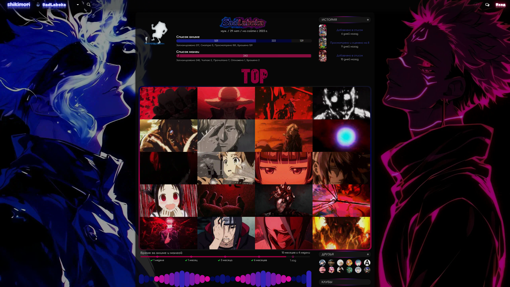
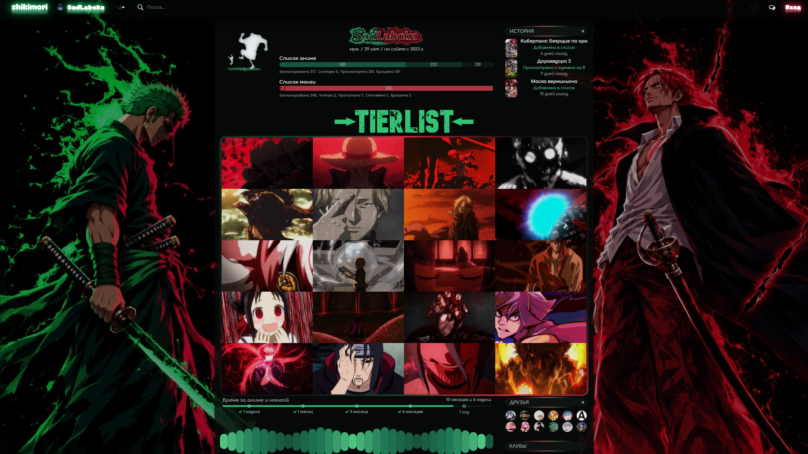
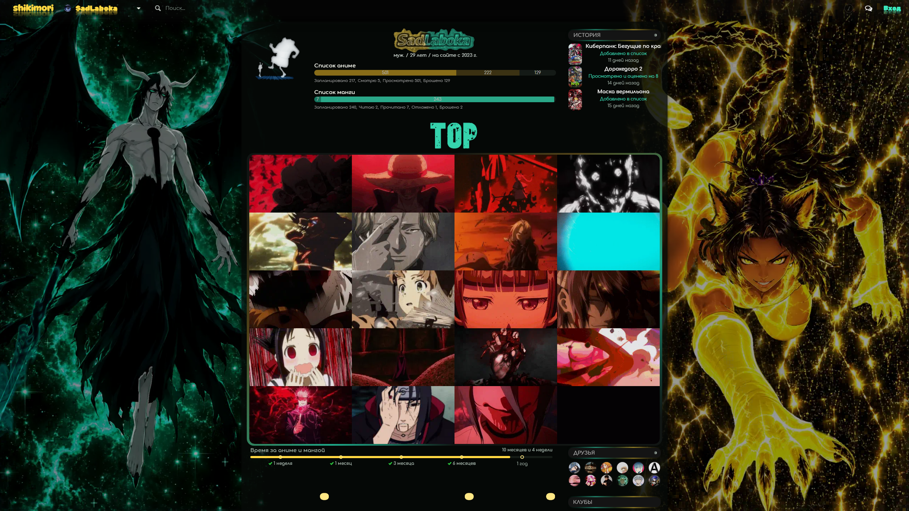
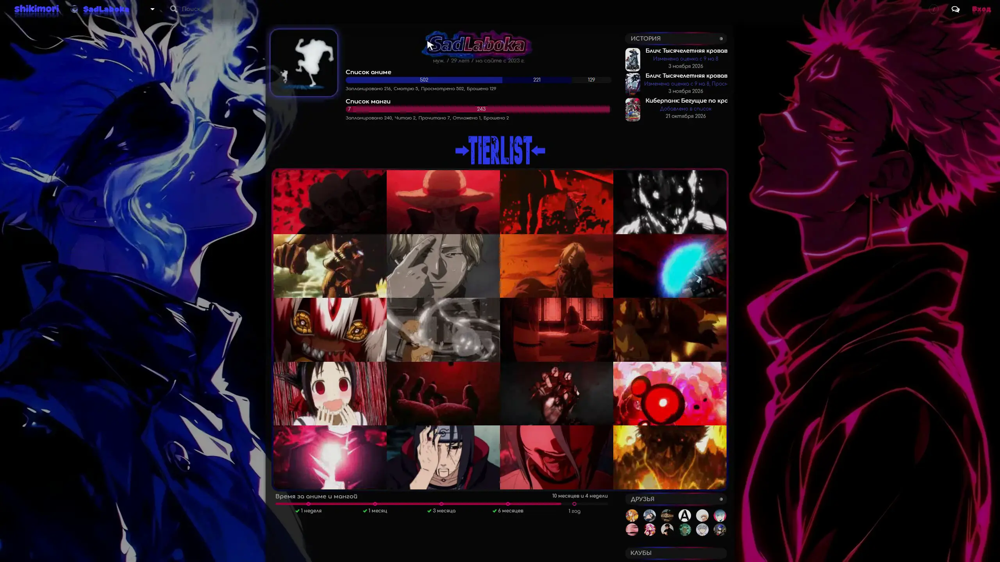

# Shikimori · SadLaboka

Мой личный репозиторий оформления [профиля SadLaboka](https://shikimori.io/SadLaboka).
Веду его исключительно для себя: цветовые схемы, расширение Firefox и инструменты
рассчитаны только на мой аккаунт. README — памятка по своему оформлению,
переключению схем и обслуживанию репозитория.

В оформлении три цветовые схемы,
анимированные фоны, меню, аватар, блок TOP, избранное, достижения, график активности
и фильтры. CSS действует на всём Shikimori, где применяется стиль профиля.

## Цветовые схемы

| Схема | Палитра и изображения | Полный CSS |
| --- | --- | --- |
| Основная | Синие и малиновые акценты, исходные фоны и анимации | [styles_optimized.css](styles_optimized.css) |
| Emerald & Scarlet | Изумрудные и алые акценты, Зоро слева и Шанкс справа, перекрашенные баннер и аватар | [styles.css](css/themes/emerald-scarlet/styles.css) |
| Gold & Jade | Золотые и бирюзовые акценты, Улькиорра слева и Йоруичи справа, мягкое затухание внутренних краёв и анимированная полоса над центром, перекрашенные SadLaboka и TOP/TIERLIST | [styles.css](css/themes/gold-jade/styles.css) |

Для переключения заменяется **весь CSS** выбранным файлом. Все три схемы
также доступны готовыми блоками импортов через расширение Firefox;
две собранные схемы не нужно накладывать друг на друга.
[Устройство альтернативной схемы и возврат к основной](css/themes/emerald-scarlet/README.md).
[Файлы Gold & Jade, ресурсы и сохранённые варианты](css/themes/gold-jade/README.md).

### Основная схема



### Emerald & Scarlet



В Emerald & Scarlet боковые фоны включаются от ширины 1280 px.

### Gold & Jade



Выбран вариант 2.2: слева — Улькиорра с золотыми акцентами интерфейса,
справа — новая Йоруичи с бирюзовыми. Улькиорра отражён, Йоруичи показана
без отражения; внутренние края плавно затухают в чёрный. Над центром проходит
анимированная полоса. Фоны включаются от 1280 px.
Анимации SadLaboka и TOP/TIERLIST перекрашены с сохранением кадров,
таймингов и прозрачности. Основная схема остаётся в корневом CSS.

Для ручного переключения используется [полный CSS Gold & Jade](css/themes/gold-jade/styles.css).
Она также доступна в Firefox-переключателе. Оригинал анимации Йоруичи хранится
в этом репозитории и подключён прямой ссылкой, закреплённой коммитом.

## Расширение Firefox

Моё расширение [Shikimori · SadLaboka](extensions/firefox/) переключает
«Основную», «Emerald & Scarlet» и «Gold & Jade» через API Shikimori. Оно меняет сохранённый CSS
моего аккаунта, используя уже выполненный вход в Firefox. Выбранное оформление будет
видно посетителям, которым сайт показывает тему профиля.

Перед записью расширение проверяет аккаунт и текущий CSS, сохраняет предыдущую
версию и сверяет результат. Кнопка «Вернуть предыдущий CSS» восстанавливает
резервную копию; в Firefox хранятся последние пять копий. После потерянного ответа
повторной отправки нет — сначала проверяется состояние сервера.

Расширение отправляет небольшой готовый блок импортов. Полные файлы схем
загружает сам Shikimori; ссылки закреплены на проверенных коммитах GitHub.

Переключаю схемы нажатием на анимированную картинку поверх
аватарки в своём профиле: схемы идут по кругу «Основная →
Emerald & Scarlet → Gold & Jade → Основная». Меню выбора при этом не открывается.
Свечение по квадратному контуру со скруглёнными углами и увеличение при наведении
входят в CSS всех схем и видны посетителям после сохранения оформления. Обработчик
нажатия работает через расширение и проверяет аккаунт перед записью.



Локальная демонстрация схем: 2560×1440, 25 кадров/с, анимированный WebP.
Нажатие обрабатывает код расширения; сохранение CSS при записи имитируется.

### Моя установка и обновления

Нужен Firefox для компьютера версии 140 или новее.

Постоянная установка — [подписанный XPI](https://github.com/SadLaboka/shikimori/releases/download/firefox-v0.3.7/shikimori-schemes-0.3.7.xpi)
через `about:addons` → ⚙ → «Установить дополнение из файла…».

Для временной проверки своей локальной копии —
`about:debugging#/runtime/this-firefox` → «Загрузить временное дополнение…» →
[`extensions/firefox/manifest.json`](extensions/firefox/manifest.json).
Переключение работает при выполненном входе как **SadLaboka** и открытой вкладке
`https://shikimori.io/`.

Временная установка действует до перезапуска Firefox. Локально собранные ZIP/XPI
создаются без подписи; постоянная установка использует подписанный файл из выпуска.
Расширение предназначено только
для аккаунта SadLaboka. [Использование, сборка и проверки](extensions/firefox/README.md).

После первой установки подписанного XPI последующие подписанные версии Firefox
может получать сам. Кнопка «Проверить обновления» в меню расширения проверяет последний
выпуск и предлагает скачать подписанный XPI; установку подтверждает Firefox.
Сборка и отправка Mozilla запускаются отдельной отметкой
`firefox-v<версия>`, а не обычным изменением CSS.
[Выпуск, подпись и автообновления](docs/firefox-release.md).

## Устройство репозитория

Автосмена независимо от Firefox подготовлена отдельным GitHub Actions workflow.
Она выключена до настройки отдельного OAuth-доступа и явного включения.
[Настройка, совместимость с расширением и добавление схем](docs/scheme-rotation.md).

Четыре файла общей CSS-основы подключаются из этого репозитория
по закреплённым commit-URL, шрифты — через
Google Fonts. Собственные правила разделены на компоненты; цветовые схемы
используют общую основу и свои переопределения.

| Путь | Назначение |
| --- | --- |
| [css/components/](css/components/) | Общие компоненты основной темы и мобильная адаптация |
| [css/components.json](css/components.json) | Порядок склейки компонентов |
| [css/themes/](css/themes/) | Отдельные схемы, их исходники, полные CSS и готовые изображения |
| [about.md](about.md) | Общий BBCode раздела «Обо мне» и блока TOP |
| [vendor/](vendor/) | Эталонные сторонние стили и сведения об авторах |
| [extensions/firefox/](extensions/firefox/) | Отдельный модуль расширения: интерфейс, схемы и публикация через API |
| [tools/preview/](tools/preview/) | Playwright-предпросмотр и проверки |
| [scripts/deploy.ps1](scripts/deploy.ps1) | Публикация через API с diff, резервной копией и сверкой результата |
| [scripts/package-firefox-extension.ps1](scripts/package-firefox-extension.ps1) | Сборка ZIP и неподписанного XPI расширения |
| [.github/workflows/firefox-release.yml](.github/workflows/firefox-release.yml) | Проверки, подпись Mozilla и выпуск обновлений Firefox |
| [tests/](tests/) | Проверки сборки, публикации и расширения |
| [docs/images/](docs/images/) | Выбранные скриншоты для README |
| [AGENTS.md](AGENTS.md) | Правила работы с проектом |

## Изменения и проверка

Основные исходники редактируются в `css/components/`, особенности отдельных схем —
в `css/themes/<slug>/`. Сначала собирается кандидат в `.preview/`,
затем проверяется в браузере. В итоговый файл переносятся проверенные байты.

```powershell
# Проверка актуальности готовых схем без изменения CSS
node scripts/build-css.mjs --check
node scripts/build-emerald-scarlet.mjs --check
node scripts/build-gold-jade.mjs --check
```

[Сборка основной темы](docs/components.md) ·
[Сборка Emerald & Scarlet](css/themes/emerald-scarlet/README.md) ·
[Сборка Gold & Jade](css/themes/gold-jade/README.md) ·
[Предпросмотр](docs/preview.md).

Для CSS проверяются затронутые компоненты, состояния и ширины 1440/390/360 px;
для боковых фонов — также широкий экран и граница медиазапроса.
Миграционные проверки требуют эквивалентности и отличаются от проверки
намеренно изменённой палитры. Ограничения конкретной проверки сохраняются в отчёте.

Публикация и git push — отдельные действия. Push обновляет репозиторий,
а при работе из терминала CSS профиля отправляется через `scripts/deploy.ps1`.
Расширение публикует выбранный блок импортов непосредственно через API.
При публикации схемы из терминала
нужно явно выбрать её `-CssPath` и передать проверенный SHA256.
Перед заменой сохраняется серверная резервная копия; основная тема остаётся
в корневом `styles_optimized.css`. [Короткий порядок выпуска](docs/release.md).

Локальные настройки, credentials, резервные копии и рабочие отчёты исключены
из Git. В репозиторий включены только выбранные снимки для README и готовые
изображения схем; остальные captures хранятся в игнорируемых каталогах.

## Проектные навыки

- [Цветовые схемы](.agents/skills/shikimori-color-schemes/SKILL.md) — отдельная сборка, ресурсы, переключение и возврат.
- [Перекраска анимаций](.agents/skills/shikimori-animated-recolor/SKILL.md) — WebP/GIF с сохранением кадров, прозрачности и таймингов.
- [Дизайн CSS](.agents/skills/shikimori-css-design/SKILL.md) — точечные изменения и визуальная проверка.
- [Миграция CSS](.agents/skills/shikimori-css-migration/SKILL.md) — перенос импортов с проверкой каскада и эквивалентности.

## Документация и авторство

[Архитектура](docs/architecture.md) · [Публикация и OAuth](docs/deployment.md) ·
[Миграция](docs/style-migration.md) · [Производительность](docs/performance.md).

В оформлении используются модули
[CSS-club](https://shikimori.io/clubs/811-css-club-nastroyka-vneshnego-vida-sayta).
Шрифты Rubik Spray Paint и DynaPuff подключены через Google Fonts.
Изображения размещены на внешнем хостинге; авторство и условия использования
стороннего кода, шрифтов и изображений остаются у их правообладателей.
Источники перенесённого CSS указаны в [vendor/README.md](vendor/README.md).
